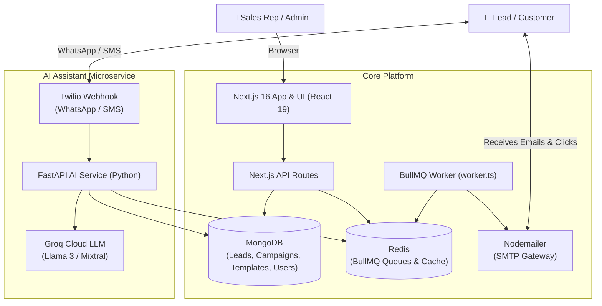

# 🚀 Sales Automation & AI Sales Assistant Platform

[](https://nextjs.org/)
[](https://react.dev/)
[](https://www.typescriptlang.org/)
[](https://tailwindcss.com/)
[](https://www.mongodb.com/)
[](https://redis.io/)
[](https://bullmq.io/)
[](https://fastapi.tiangolo.com/)
[](https://groq.com/)
[](https://www.twilio.com/)

An enterprise-grade, multi-channel **Sales Automation & CRM Platform** combining a high-performance **Next.js 16** web application with a distributed **BullMQ + Redis** background processing engine and a **FastAPI + Groq AI** conversational sales assistant.

---

## 📑 Table of Contents

- [Key Features](#-key-features)
- [System Architecture](#-system-architecture)
- [Tech Stack](#-tech-stack)
- [Repository Structure](#-repository-structure)
- [Prerequisites](#-prerequisites)
- [Environment Configuration](#-environment-configuration)
- [Getting Started](#-getting-started)
  - [1. Next.js Web App](#1-nextjs-web-app)
  - [2. BullMQ Email Worker](#2-bullmq-email-worker)
  - [3. AI Chatbot Microservice](#3-ai-chatbot-microservice)
- [Docker Deployment](#-docker-deployment)
- [API Endpoints Overview](#-api-endpoints-overview)
- [Scripts](#-scripts)
- [License](#-license)

---

## ✨ Key Features

### 📊 Real-Time Dashboard & Analytics
- Comprehensive overview of lead funnels, active campaigns, and conversion rates.
- Interactive data visualizations with **Recharts** and **Chart.js**.
- Detailed audit logging and event tracking.

### 📧 Scalable Email Microservice
- **Queue-Driven Delivery**: Powered by **BullMQ** and **Redis** for rate-limiting, retries, and high-throughput background processing.
- **Dynamic Template Builder**: Rich WYSIWYG editor built with **Tiptap** supporting variables (e.g., `{{name}}`), dynamic injection, and responsive previews.
- **Engagement Tracking**: Automated email open tracking pixels and link click tracking.
- **Unsubscribe Management**: Built-in compliance and automated opt-out handling.

### 💬 Multi-Channel WhatsApp Automation
- Direct messaging and template broadcast campaigns.
- Real-time WhatsApp webhook synchronization with incoming & outgoing status reports.
- Contact conversation inbox for live sales rep engagement.

### 🤖 AI Sales Agent Microservice (`services/ai_chat_bot`)
- **FastAPI + Groq LLM**: Ultra-low latency responses using Groq Llama 3 models.
- **Twilio Integration**: Autonomous two-way WhatsApp & SMS conversation handling via TwiML webhooks.
- **Autonomous Tool Router**: Lead qualification, CRM data synchronization, and automated calendar scheduling.
- **Follow-up Engine**: Configurable conversation lifecycles with automatic reminders and auto-close timers.

### 👥 Contact & Lead Management
- Bulk contact import via CSV parser.
- Segmentation, custom tags, and lifecycle stage tracking.
- Integrated contact profiles with full interaction histories.

### 🔐 Authentication & Security
- Secure session authentication with JWT (**jose** & **jsonwebtoken**) and **bcryptjs** password hashing.
- Route-level middleware protection and secure API credentials management.

---

## 🏛 System Architecture



---

## 🛠 Tech Stack

| Layer | Technologies |
|---|---|
| **Frontend Framework** | [Next.js 16](https://nextjs.org/) (App Router), [React 19](https://react.dev/), [TypeScript](https://www.typescriptlang.org/) |
| **Styling & UI** | [Tailwind CSS v4](https://tailwindcss.com/), [Shadcn UI](https://ui.shadcn.com/), [Framer Motion](https://www.framer.com/motion/), [Lucide React](https://lucide.dev/) |
| **Rich Text Editor** | [Tiptap](https://tiptap.dev/) (Starter Kit, Link, React extensions) |
| **Charts & Metrics** | [Recharts](https://recharts.org/), [Chart.js](https://www.chartjs.org/), [React-Chartjs-2](https://react-chartjs-2.js.org/) |
| **Backend & Queues** | Next.js API Routes, [BullMQ](https://bullmq.io/), [ioredis](https://github.com/redis/ioredis), [Node-Cron](https://github.com/node-cron/node-cron) |
| **Database & ODM** | [MongoDB](https://www.mongodb.com/), [Mongoose 9](https://mongoosejs.com/) |
| **Email Gateway** | [Nodemailer](https://nodemailer.com/) |
| **AI Microservice** | [Python 3.11+](https://www.python.org/), [FastAPI](https://fastapi.tiangolo.com/), [Groq SDK](https://groq.com/), [Twilio SDK](https://www.twilio.com/) |
| **Containerization** | [Docker](https://www.docker.com/), Docker Compose |

---

## 📂 Repository Structure

```text
sales-automation/
├── my-app/                               # Main Next.js Fullstack Application
│   ├── public/                           # Static assets and icons
│   ├── scripts/                          # Utility build and cache-cleaning scripts
│   ├── src/
│   │   ├── app/                          # Next.js App Router
│   │   │   ├── (auth)/                   # Authentication pages (sign-in, sign-up)
│   │   │   ├── Campaign/                 # Campaign management views
│   │   │   ├── Contacts/                 # Contact & lead management
│   │   │   ├── Dashboard/                # Analytics and reporting
│   │   │   ├── templates/                # Rich email template builder
│   │   │   ├── whatsapp/                 # WhatsApp communication & inbox
│   │   │   └── api/                      # Next.js REST API endpoints
│   │   │       ├── auth/                 # Sign-in, sign-up, session verify
│   │   │       ├── automation/           # Automation workflows
│   │   │       ├── campaigns/            # Campaign triggers and lifecycle
│   │   │       ├── dashboard/            # Aggregate metrics
│   │   │       ├── email/                # Send, track, analytics, unsubscribe
│   │   │       ├── leads/                # Lead CRUD and bulk import
│   │   │       ├── templates/            # Template CRUD operations
│   │   │       └── whatsapp/             # WhatsApp messaging endpoints
│   │   ├── Components/                   # Reusable UI components & modals
│   │   ├── lib/                          # Database connection, auth helpers, utils
│   │   ├── modules/                      # Business domain logic
│   │   ├── queues/                       # BullMQ queue definitions and workers
│   │   └── services/                     # External integration clients
│   ├── services/
│   │   └── ai_chat_bot/                  # Python FastAPI AI Sales Assistant
│   │       ├── app/                      # FastAPI core, routers, services, tools
│   │       ├── tests/                    # Pytest test suite
│   │       ├── Dockerfile                # AI microservice container
│   │       ├── docker-compose.yml        # Docker compose configuration
│   │       └── requirements.txt          # Python dependencies
│   └── package.json                      # Next.js dependencies and scripts
├── .gitignore                            # Root Git ignore rules
└── README.md                             # Project documentation
```

---

## 📦 Prerequisites

Ensure you have the following installed locally:
- [Node.js](https://nodejs.org/) (v20+ recommended)
- [npm](https://www.npmjs.com/) or [pnpm](https://pnpm.io/)
- [Python](https://www.python.org/) 3.10+ (for AI microservice)
- [MongoDB](https://www.mongodb.com/) (running locally or a MongoDB Atlas URI)
- [Redis](https://redis.io/) (running locally or via Docker)
- [Docker](https://www.docker.com/) (optional, for containerized services)

---

## ⚙️ Environment Configuration

### Next.js App (`my-app/.env.local`)
Create a `.env.local` file inside the `my-app` directory:

```env
# Database
MONGODB_URI=mongodb://localhost:27017/sales-automation

# Redis (for BullMQ queues)
REDIS_HOST=localhost
REDIS_PORT=6379
REDIS_PASSWORD=

# Authentication
JWT_SECRET=your_super_secret_jwt_key
NEXTAUTH_URL=http://localhost:3000

# Email (SMTP Nodemailer)
SMTP_HOST=smtp.gmail.com
SMTP_PORT=587
SMTP_USER=your_email@gmail.com
SMTP_PASS=your_app_password
EMAIL_FROM="Sales Automation" <your_email@gmail.com>

# Tracking & Base URL
NEXT_PUBLIC_APP_URL=http://localhost:3000
```

### AI Chatbot Microservice (`my-app/services/ai_chat_bot/.env`)
Create a `.env` file inside `my-app/services/ai_chat_bot`:

```env
# Groq AI
GROQ_API_KEY=your_groq_api_key

# Twilio Credentials
TWILIO_ACCOUNT_SID=your_twilio_account_sid
TWILIO_AUTH_TOKEN=your_twilio_auth_token
TWILIO_PHONE_NUMBER=+1234567890

# Cloudinary (Media storage)
CLOUDINARY_CLOUD_NAME=your_cloud_name
CLOUDINARY_API_KEY=your_api_key
CLOUDINARY_API_SECRET=your_api_secret

# Microservice Redis & Notifications
REDIS_URL=redis://localhost:6379/0
SMTP_EMAIL=your_email@example.com
SMTP_PASSWORD=your_smtp_app_password
OWNER_EMAIL=owner@example.com
REMINDER_AFTER_MINUTES=2
CLOSE_AFTER_MINUTES=5
```

---

## 🚀 Getting Started

### 1. Next.js Web App

Navigate to `my-app` and install dependencies:

```bash
cd my-app
npm install
```

Start the local development server:

```bash
npm run dev
```

The application will be running at [http://localhost:3000](http://localhost:3000).

---

### 2. BullMQ Email Worker

The email dispatch and job processing worker runs asynchronously:

```bash
cd my-app
npm run worker
```

> **Note**: Make sure your Redis instance is running before launching the worker (`docker run -p 6379:6379 redis`).

---

### 3. AI Chatbot Microservice

To run the Python AI Sales Assistant:

```bash
cd my-app/services/ai_chat_bot
python -m venv .venv

# On Windows:
.venv\Scripts\activate
# On macOS/Linux:
source .venv/bin/activate

pip install -r requirements.txt
uvicorn app.main:app --reload --host 0.0.0.0 --port 8000
```

Verify service status:
```bash
curl http://localhost:8000/
# Expected: {"status":"running"}
```

---

## 🐳 Docker Deployment

To spin up Redis quickly:

```bash
docker run -d --name redis-server -p 6379:6379 redis:alpine
```

To run the AI Chatbot microservice with Docker:

```bash
cd my-app/services/ai_chat_bot
docker-compose up --build -d
```

---

## 🔌 API Endpoints Overview

| Method | Endpoint | Description |
|---|---|---|
| `POST` | `/api/auth/sign-in` | User authentication & JWT issuance |
| `POST` | `/api/auth/sign-up` | New user registration |
| `GET` | `/api/dashboard` | Dashboard analytics & metric summaries |
| `POST` | `/api/email/send` | Enqueue email send request via BullMQ |
| `GET` | `/api/email/analytics` | Email engagement, open, & click rates |
| `GET` | `/api/email/track-click` | Tracking redirect handler for email links |
| `GET` | `/api/email/unsubscribe` | Contact unsubscribe handler |
| `GET/POST` | `/api/leads` | Retrieve or create leads / contacts |
| `POST` | `/api/leads/import` | Parse and import contacts via CSV |
| `GET/POST` | `/api/campaigns` | Manage email and WhatsApp campaigns |
| `GET/POST` | `/api/templates` | Create and fetch reusable email templates |
| `POST` | `/api/whatsapp/send` | Send direct or template WhatsApp message |
| `POST` | `/webhook` *(FastAPI :8000)* | Incoming Twilio WhatsApp/SMS webhook for AI Bot |

---

## 📜 Scripts

| Command | Description |
|---|---|
| `npm run dev` | Runs the Next.js development server with hot-reload |
| `npm run build` | Compiles Next.js for production deployment |
| `npm run start` | Starts Next.js production server |
| `npm run lint` | Runs ESLint checks across codebase |
| `npm run test` | Executes unit tests via `tsx` |
| `npm run worker` | Starts the BullMQ background worker |

---

## 📄 License

This project is licensed under the [MIT License](LICENSE).
